## ▶ 50 saniyede ben

## Öne çıkan projeler

  
  
  
  
  

<b>Tüm projeler ve kanıtlar (tablo)</b>

| Proje | Hangi sorunu çözüyor? | Kanıt |
| --- | --- | --- |
| **[Vidolya](case-studies/vidolya.md)** · canlı SaaS | Restoran, kuyumcu ve butikler ürün fotoğrafından dakikalar içinde dikey reklam videosu üretir; ajansa ve çekime gerek kalmaz. | Platformda **370+ video** üretildi · atomik kredi sistemi · maliyet korumaları · [vaka çalışması](case-studies/vidolya.md) |
| **[KârKontrol](https://github.com/nowackk-cp/karkontrol)** · test ve kalite | Pazaryeri satıcısının kâr hesabını doğrular: 1 kuruşluk fiyat farkı kargo baremini değiştirip kârı 29,99 ₺ düşürebilir. | **669** test · **13** Playwright E2E · mutasyon skoru **%98,83** · LLM asistan **52/52** · [canlı raporlar](https://nowackk-cp.github.io/karkontrol/) |
| **[B2B Operations Suite](https://github.com/nowackk-cp/b2b-operations-suite)** · full-stack | Sipariş, stok, depo, fatura ve iade süreçlerini tek panelde yönetir; stok ve para hiçbir zaman "yaklaşık" değildir. | NestJS + Next.js + PostgreSQL · boşluksuz fatura numarası · idempotent işlemler · **576** API + **133** DB + **180** web + **19** E2E testi |
| **[Jev](https://github.com/nowackk-cp/jev)** · AI ajan orkestrasyonu | Tek cümlelik bir isteği Claude Code ve Codex ajanlarından oluşan bir yazılım ekibine dağıtır, sonuçları doğrular, raporlar. | Paralel Git worktree'leri · sözleşmeli görev kartları · [interaktif demo](https://nowackk-cp.github.io/jev/) |
| **[Ortak](https://github.com/nowackk-cp/ortak)** · çoklu AI ajan | Bilgisayarda kurulu Claude Code, Codex, Gemini, Copilot gibi 11 ajanı tek arayüzde toplar; tartıştırır, işi böler, birbirini denetletir. Kendi aracı olmayan modellere dosya ve terminal "eli" olur. | 6 çalışma modu · paralel Git worktree'leri · geri alma noktaları · **0** npm bağımlılığı · [animasyonlu tanıtım](https://github.com/nowackk-cp/ortak#readme) |
| **Gerçek zamanlı nesne tespiti** · görüntü işleme | Oyun içi nesneleri canlı görüntüde tespit eder. | 8.000 görüntülük özel veri setiyle YOLOv8 eğitimi |
| **[Üçbay](https://xn--bay-1la8h.com)** · müşteri projesi | Tekstil tedarikçisi için iki dilli kurumsal site. | Ürün/kategori sayfaları · WhatsApp entegrasyonu |

## Nasıl çalışıyorum?

- **AI ile hız, testle güven.** Claude Code, Cursor ve Codex ile hızlı geliştiriyorum. Her iddiayı bir test, ölçüm veya CI kaydına bağlıyorum.
- **İş kuralları önce gelir.** Para, stok ve kredi gibi hataya tahammülü olmayan akışları veritabanı seviyesinde atomik yapıyorum.
- **LLM'i ölçmeden yayına almıyorum.** Soru setleri, regresyon takibi ve GitHub Actions ile model davranışını sürekli kontrol ediyorum.

## Teknolojiler

Animasyonlar harici servis kullanmayan, kodla üretilmiş SVG'lerdir · <code>python tools/build_readme_svgs.py</code>

---

<b>🇬🇧 English</b>

### Ahmet Emre Yıldız — Full-stack & AI Application Developer

**I ship fast with AI coding agents and prove correctness with tests.**

| Project | Problem it solves | Evidence |
| --- | --- | --- |
| **[Vidolya](case-studies/vidolya.md)** · live SaaS | Turns a product photo into a vertical ad video for restaurants, jewellers and boutiques, with no agency or shoot needed. | **370+ videos** generated · atomic credit system · cost guards |
| **[KârKontrol](https://github.com/nowackk-cp/karkontrol)** · QA | Verifies marketplace sellers' profit math: one cent can push an order into the next shipping tier and cost ₺29.99. | **669** tests · **13** E2E · **98.83%** mutation score · LLM assistant **52/52** |
| **[B2B Operations Suite](https://github.com/nowackk-cp/b2b-operations-suite)** · full-stack | Orders, stock, warehouses, invoices and returns, with transactional stock and gapless invoice numbering. | NestJS · Next.js · PostgreSQL · **576** API / **133** DB / **180** web / **19** E2E tests |
| **[Jev](https://github.com/nowackk-cp/jev)** · AI agents | Turns one sentence into a team of Claude Code and Codex agents that plan, code in parallel worktrees and verify. | [Interactive demo](https://nowackk-cp.github.io/jev/) |
| **[Ortak](https://github.com/nowackk-cp/ortak)** · multi-agent | Puts 11 locally installed AI agents (Claude Code, Codex, Gemini, Copilot…) at one table: they debate, split work and review each other. Gives text-only models file and terminal hands. | 6 work modes · parallel Git worktrees · undo checkpoints · **0** npm dependencies |
| **Real-time object detection** · CV | Detects in-game objects live. | YOLOv8 trained on 8,000 custom images |

Python · TypeScript · Django · Next.js · NestJS · PostgreSQL · Supabase · pytest · Playwright · GitHub Actions · YOLOv8 · LLM evaluation

